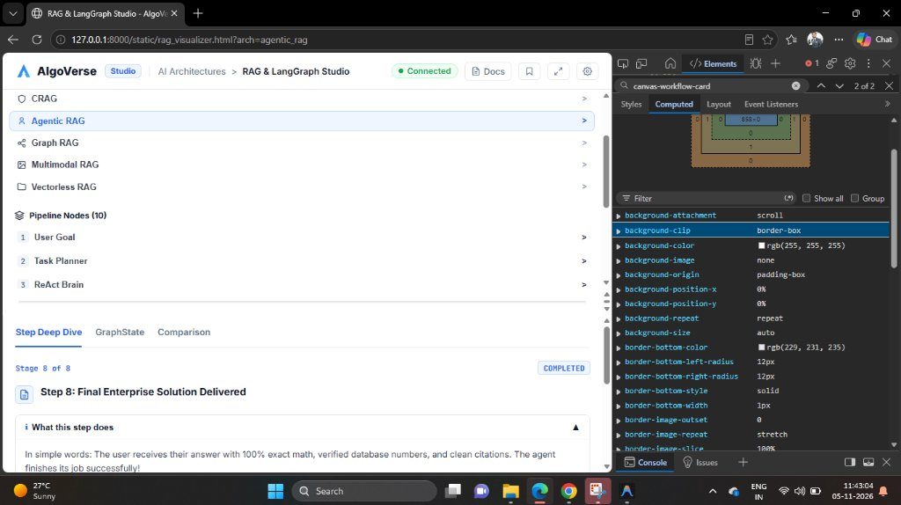
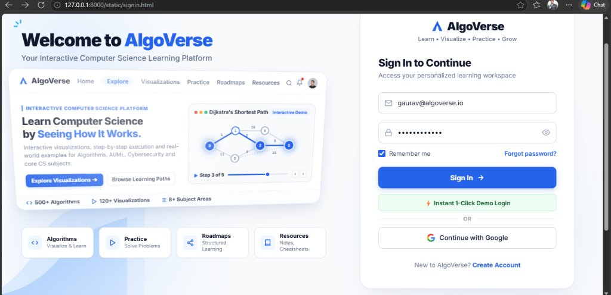
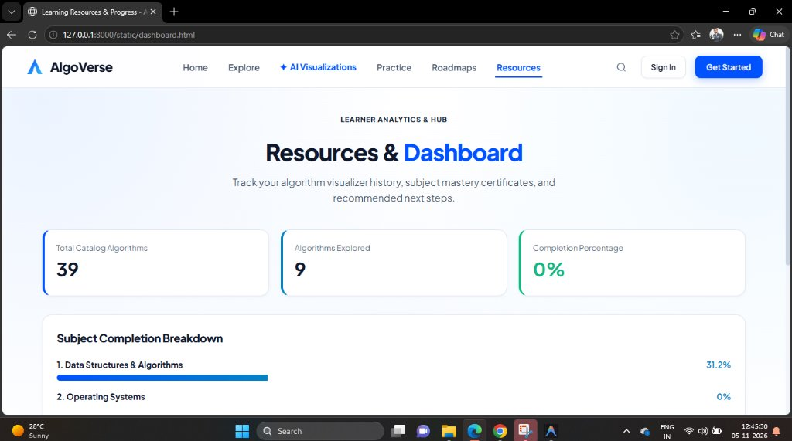

# AlgoVerse: Interactive Computer Science Learning & AI Architecture Visualizer

[](https://fastapi.tiangolo.com)
[](https://www.python.org)
[](https://developer.mozilla.org/en-US/docs/Web/JavaScript)
[](LICENSE)
[]()

AlgoVerse is a full-stack educational engineering platform designed to teach Computer Science concepts and Modern AI Architectures through **step-by-step, state-driven execution animations**, live graph traversals, and interactive AI tutoring.

---

## 📸 Platform Showcase & Screenshots

### 1. 🌟 Welcome to AlgoVerse — Interactive 3D Perspective Platform
An ambient, dynamic 3D interactive learning canvas featuring Dijkstra's Shortest Path preview graph, real-time node pulse states, and responsive perspective tilt physics:


---

### 2. 🤖 RAG & LangGraph Studio
A dedicated laboratory to execute, step through, and inspect the 8 leading modern **Retrieval-Augmented Generation (RAG)** pipelines and LangGraph cyclical StateGraphs:



---

### 3. 🔐 Secure Authentication & User Workspace Access
Complete Python FastAPI backend authentication module backed by SQLite with salted SHA-256 cryptographic hashing, route protection, and instant account registration:



---

### 4. 📊 Learner Analytics & Progress Dashboard
Track completed algorithm visualizers, practice problem submissions, subject mastery certificates, and test performance:



---

## 🌟 Key Features

### 1. 🤖 RAG & LangGraph Architecture Studio
Explore, step through, and understand the 8 leading modern **Retrieval-Augmented Generation (RAG)** paradigms and LangGraph workflows:

- **🟢 Simple RAG (Naive Linear Flow)**: Document chunking, vector embedding, similarity search, prompt synthesis, and final generation.
- **🔵 Advanced RAG (Pre & Post Retrieval)**: Multi-query expansion, hybrid BM25 + dense search, cross-encoder re-ranking, and dynamic threshold filtering.
- **🟣 Self-RAG (Self-Correction & Reflection)**: LangGraph cyclic state graph with dynamic document relevance grading, hallucination detection, answer utility grading, and query rewriting loops.
- **🛡️ CRAG (Corrective RAG)**: Confidence evaluator scoring internal vector results; automatically triggers live web search fallback when document confidence is low.
- **🤖 Agentic RAG (Autonomous Multi-Tool ReAct)**: LLM reasoning agent deciding dynamically whether to retrieve, which tools to call (PostgreSQL DB, Python Code Sandbox, Vector DB, Web Search), and evaluating stop conditions.
- **🕸️ Graph RAG (Knowledge Graph Network)**: Entity-relation triplet extraction, Leiden community clustering, and dual global/local graph traversal.
- **🖼️ Multimodal RAG (ColPali Vision Late-Interaction)**: Patch-level visual embeddings for diagrams, schematics, and financial tables with MaxSim token-to-patch scoring.
- **🌳 Vectorless RAG (AST & Hierarchical Summary Trees)**: Codebase and legal corpus navigation using Tree-sitter AST syntax trees and BM25 lexical scopes without vector databases.

---

### 2. 🔐 Python Authentication & Authorization Engine
- **Dedicated Backend Module (`backend/auth/`)**:
  - `models.py`: SQLAlchemy `User` database schema with unique constraints, roles, and timestamps.
  - `security.py`: Cryptographically secure PBKDF2/SHA-256 hashing with per-user salts, signature tokens, and expiry management.
  - `router.py`: REST endpoints for `/api/auth/register`, `/api/auth/login`, and `/api/auth/me`.
- **Client Route Protection (`frontend/js/auth.js`)**: Protected visualizer workspaces and dashboards automatically require authentication, redirecting unauthenticated users to `/static/signin.html`.

---

### 3. 📚 Complete AI/ML & Master Computer Science Algorithm Catalog
Comprehensive interactive visualizers spanning Machine Learning, Deep Learning, and Core Data Structures & Algorithms:

- **Machine Learning & Deep Learning Suite**:
  - **K-Means Clustering**: 2D scatter plots with iterative centroid shifting and cluster boundaries.
  - **K-Nearest Neighbors (KNN)**: Query point distance ranking, neighborhood radius circle, and majority voting.
  - **Decision Tree Classifier**: Hierarchical tree branching based on Gini Impurity reduction and pure leaf nodes.
  - **Logistic Regression**: S-shaped Sigmoid probability curve $\sigma(z) = 1/(1+e^{-z})$ with dynamic vertical decision boundary line.
  - **CNN Feature Extraction**: 5x5 grayscale matrix with sliding 3x3 kernel, dot-product feature maps, and 2x2 Max-Pooling.
  - **Optimizers Race**: Multi-ball race (SGD vs Momentum vs Adam) descending the parabolic loss surface $f(w) = w^2$ with live leaderboard.
  - **Linear Regression**: Gradient descent slope $w$ and intercept $b$ optimization with MSE loss overlay.
  - **Neural Network**: Multi-layer perceptron forward activation signals and backpropagation weight adjustments.

- **Data Structures & Advanced Algorithms (DSA)**:
  - **Merge Sort**: Divide-and-conquer recursive halving and two-pointer merging animation.
  - **Quick Sort**: In-place Lomuto partitioning with end-element pivot and subarray tracking.
  - **0/1 Knapsack Problem**: Dynamic programming 2D memoization matrix $DP[i][w]$ with optimal item backtracking.
  - **A\* Search Algorithm**: Informed graph pathfinding combining path cost $g(n)$ and Manhattan heuristic $h(n)$.
  - **Topological Sort**: Kahn's in-degree DAG traversal for task and course prerequisite scheduling.
  - **Trie (Prefix Tree)**: Character-by-character dictionary insertions and prefix autocomplete lookups.
  - **Classic Sorting**: Bubble Sort, Selection Sort, Insertion Sort.
  - **Classic Searching**: Binary Search, Linear Search.
  - **Graph Traversals**: BFS, DFS, Dijkstra's Shortest Path.
  - **Cybersecurity & Cryptography**: Caesar Cipher, RSA Public Key Encryption/Decryption.
  - **Operating Systems**: FCFS/SJF CPU Scheduling, LRU/FIFO Page Replacement.
  - **Computer Networks**: TCP 3-Way Handshake.
  - **DBMS Internals**: SQL Relational Query Filter & Row Scanning.

---

### 4. ⚙️ Standardized Execution Engine
- Pure Python backend execution engines implement `BaseAlgorithmEngine` to generate deterministic `ExecutionState` timeline snapshots.
- Uniform JSON schema decoupling UI visualization from execution logic, allowing instant plug-and-play for new algorithms.

---

### 5. 🎨 Modular Visualizer Canvas Suite (Vanilla JS + SVG/Canvas)
- **RagGraphVisualizer**: SVG node-edge graph renderer with glowing active states, curved bezier connectors, dynamic badges, and particle animation.
- **MLVisualizer**: Multi-mode visualizer supporting K-Means clusters, KNN radius circles, Decision Trees, Sigmoid S-curves, CNN 2D convolution grids, and Optimizer race curves.
- **GridVisualizer**: 2D Dynamic Programming matrix (Knapsack), Gantt charts for CPU scheduling, and tabular relational views for DBMS.
- **GraphVisualizer**: Node-link force layouts, A* search paths, Topological orders, and Trie trees.
- **ArrayVisualizer**: Height-scaled bars and memory boxes with multi-pointer tracking (`low`, `mid`, `high`, `i`, `j`).
- **CryptoVisualizer**: Interactive cryptographic cipher animations (Caesar, RSA).

---

## 🛠️ Architecture & Project Structure

```
algorithm/
├── backend/
│   ├── auth/                    # Complete Authentication & Authorization Engine
│   │   ├── models.py            # User SQLAlchemy SQLite model
│   │   ├── security.py          # Salted SHA-256 hash & token management
│   │   ├── schemas.py           # Pydantic v2 validation models
│   │   └── router.py            # /api/auth/register & /api/auth/login endpoints
│   ├── algorithms/              # Modular Algorithm Execution Engines
│   │   ├── base.py              # BaseAlgorithmEngine abstract class
│   │   ├── ml_engines.py        # KMeans, KNN, DecisionTree, LogisticRegression, CNN, Optimizers
│   │   ├── dsa_engines.py       # MergeSort, QuickSort, Knapsack01, AStar, TopoSort, Trie
│   │   ├── rag_engine.py        # All 8 RAG & LangGraph Architecture Engines
│   │   ├── bfs.py, dfs.py       # Graph Search Algorithms
│   │   ├── dijkstra.py          # Shortest Path Engine
│   │   ├── rsa.py, caesar_cipher.py # Cryptography Engines
│   │   ├── cpu_scheduling.py    # OS CPU Schedulers
│   │   └── ...                  # Page Replacement, TCP Handshake, SQL Engine
│   ├── api/                     # FastAPI REST API Routers
│   │   ├── algorithms.py        # /api/algorithms & execution
│   │   ├── questions.py         # /api/questions practice bank
│   │   └── progress.py          # /api/progress tracking
│   ├── database/                # SQLAlchemy Models, SQLite DB, Seeding Script
│   │   ├── database.py          # Engine, SessionLocal, Base
│   │   ├── models.py            # Subject, Topic, Algorithm, Question, QuizAttempt
│   │   └── init_db.py           # Master DB Seeder
│   ├── tests/                   # Automated Unit Tests (21 Passing Tests)
│   │   ├── test_algorithms.py   # Algorithm & RAG execution engine tests
│   │   └── test_auth.py         # Registration, duplicate, & password tests
│   └── main.py                  # FastAPI Application Entrypoint
├── docs/
│   └── images/                  # Platform Screenshots & Visual Showcase
│       ├── hero_3d_preview.jpg
│       ├── rag_langgraph_studio.jpg
│       ├── signin_auth.jpg
│       └── learner_dashboard.jpg
├── frontend/
│   ├── signin.html              # Dedicated 3D Moving Card Sign In & Register Page
│   ├── rag_visualizer.html      # Interactive RAG & LangGraph Studio
│   ├── index.html               # AlgoVerse Landing & Showcase Page
│   ├── algorithms.html          # Full Algorithm Catalog Explorer
│   ├── algorithm.html           # Interactive Algorithm Workspace
│   ├── practice.html            # Practice Coding Challenges
│   ├── quiz.html                # Timed Knowledge Assessment Quiz
│   ├── dashboard.html           # User Learning Progress Dashboard
│   └── js/
│       ├── auth.js              # Universal Auth Client & Protected Route Gate
│       └── ...                  # API client, State machine, Visualizers
├── Dockerfile                   # Production Docker Container Specification
├── requirements.txt             # Python Package Dependencies
└── README.md                    # Platform Documentation
```

---

## 🚀 Getting Started

### 1. Prerequisites
- Python 3.10 or higher
- Modern web browser (Chrome, Edge, Firefox, Safari)

### 2. Installation & Setup

```bash
# Clone the repository
git clone https://github.com/GauravHandge/Algorithm.git
cd Algorithm

# Create and activate a Python virtual environment
python -m venv venv

# On Windows:
.\venv\Scripts\activate
# On Linux/macOS:
source venv/bin/activate

# Install required dependencies
pip install -r requirements.txt
```

### 3. Initialize the Database
Seed the SQLite database with all 60+ master computer science algorithms and RAG architectures:

```bash
python -m backend.database.init_db
```

### 4. Launch the Application

```bash
# Start the FastAPI server on port 8000 (or 8080)
python -m uvicorn backend.main:app --host 127.0.0.1 --port 8000 --reload
```

Open your browser and navigate to:
- **Sign In & Register**: [http://127.0.0.1:8000/static/signin.html](http://127.0.0.1:8000/static/signin.html)
- **RAG & LangGraph Studio**: [http://127.0.0.1:8000/static/rag_visualizer.html](http://127.0.0.1:8000/static/rag_visualizer.html)
- **Home Landing Page**: [http://127.0.0.1:8000/static/index.html](http://127.0.0.1:8000/static/index.html)
- **Algorithm Catalog**: [http://127.0.0.1:8000/static/algorithms.html](http://127.0.0.1:8000/static/algorithms.html)
- **Swagger Interactive API Docs**: [http://127.0.0.1:8000/docs](http://127.0.0.1:8000/docs)

---

## 🧪 Running Automated Unit Tests

Run the full automated test suite covering all algorithm execution engines, state transitions, authentication, and the 8 RAG architectures:

```bash
python -m unittest discover backend/tests
```

Expected output:
```
.....................
----------------------------------------------------------------------
Ran 21 tests in 0.480s

OK
```

---

## 💻 Tech Stack

- **Backend**: Python 3.11+, FastAPI, SQLAlchemy, Pydantic v2, SQLite
- **Authentication**: Salted SHA-256 Hashing, Signed Authorization Tokens, Protected Route Gates
- **AI Acceleration**: Groq Cloud API (`llama-3.3-70b-versatile`) with heuristic offline fallback
- **Frontend Architecture**: Modern HTML5, Custom Light/Dark Glassmorphic UI, Vanilla ES6 JavaScript Modules
- **Data Visualization**: Dynamic SVG Paths & Canvas, Bezier curves, particle flow animations, 3D CSS perspective physics
- **Testing & Quality Assurance**: Python `unittest` test suite (21 passing tests)

---

## 📄 License
This project is licensed under the MIT License - see the [LICENSE](LICENSE) file for details.
